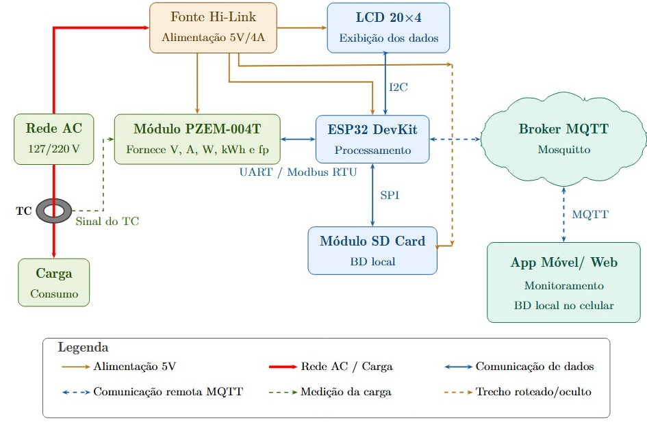
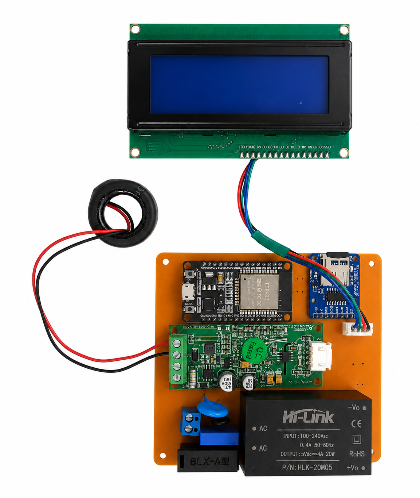
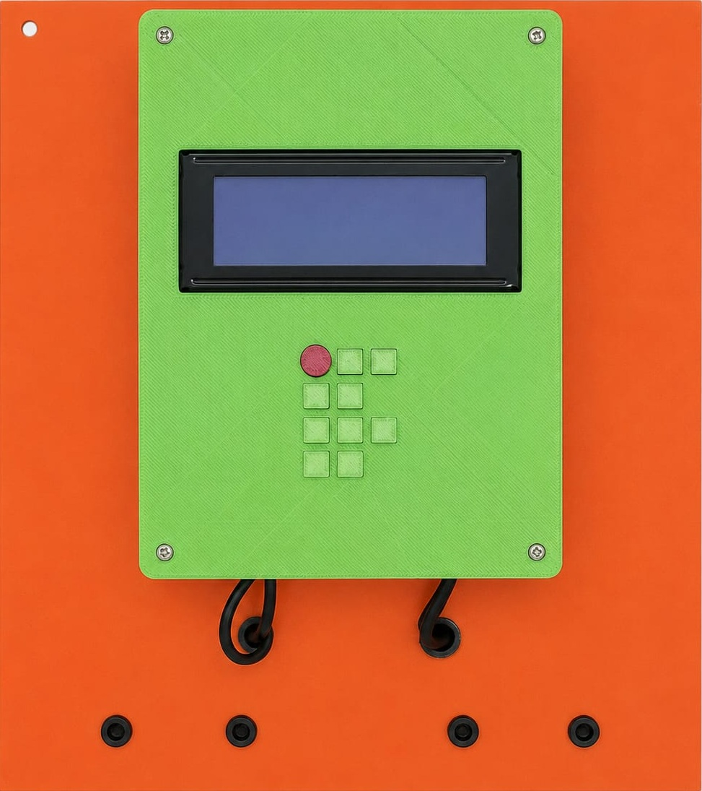
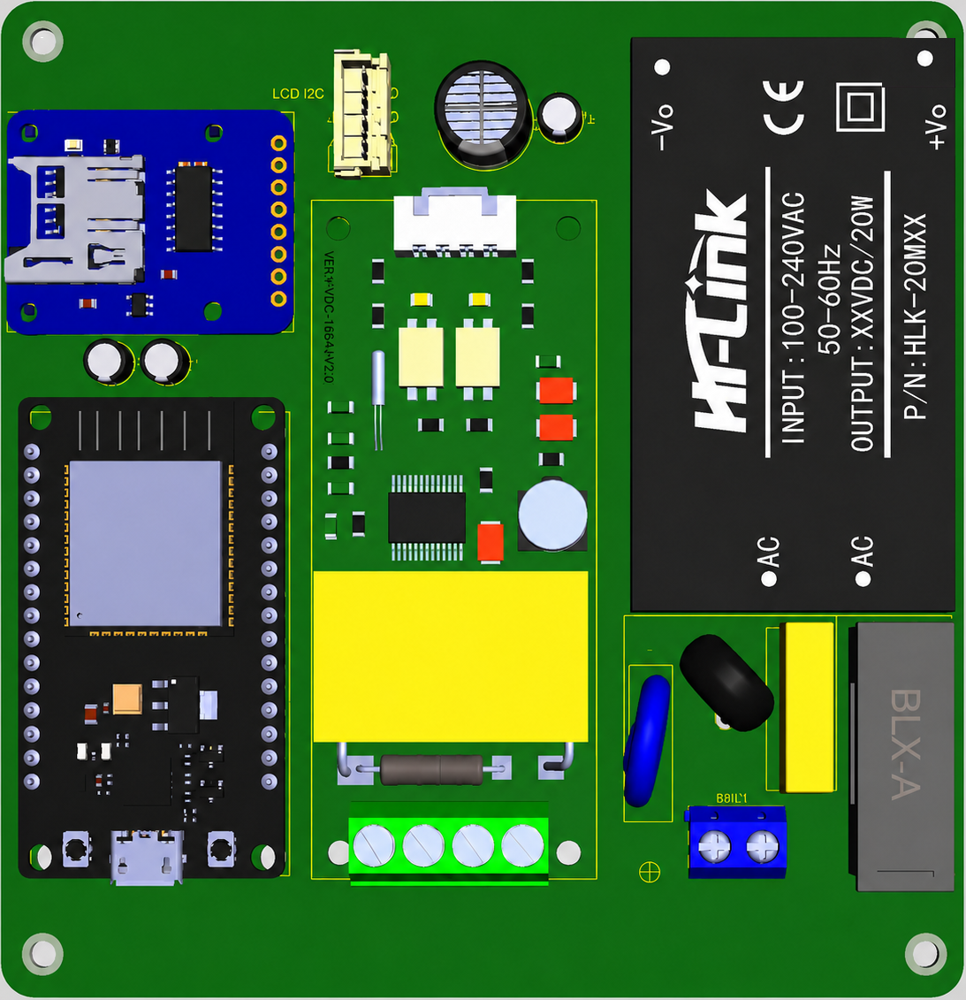
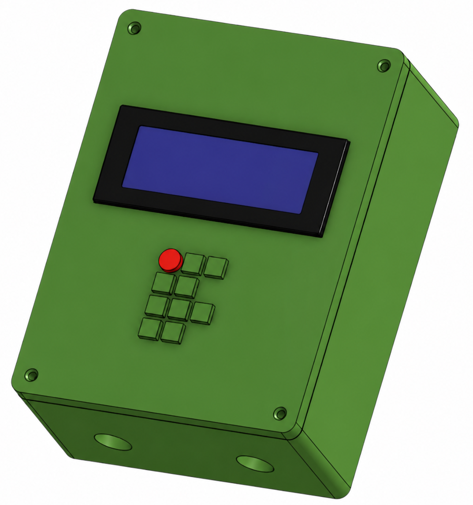
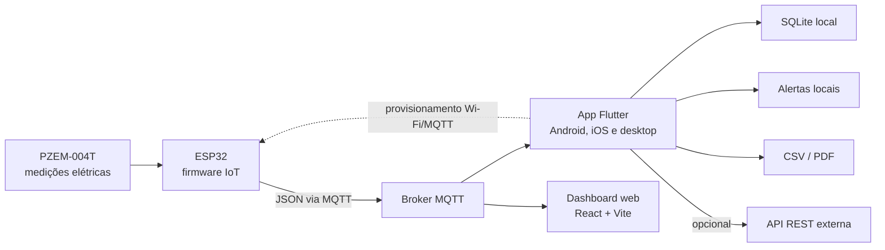

# E-Metrics IoT 📊⚡

<p align="center">
  
</p>

<p align="center">
  <strong>Plataforma IoT para monitoramento, histórico e análise de grandezas elétricas em tempo real.</strong>
</p>

<p align="center">
  <a href="https://emetricsiot.pages.dev"><strong>Dashboard em produção</strong></a>
  ·
  <a href="docs/USER_MANUAL.md">Manual do usuário</a>
  ·
  <a href="firmware/esp32_pzem/README.md">Firmware ESP32</a>
  ·
  <a href="backend_example/README.md">Backend de exemplo</a>
</p>

<p align="center">
  
  
  
  
  
</p>

<p align="center">
  
</p>

## 🎯 Visão Geral

O **E-Metrics IoT** integra hardware, aplicativo móvel/desktop e dashboard web para acompanhar medições elétricas em tempo real. O sistema recebe telemetria de um dispositivo IoT via MQTT, apresenta indicadores e gráficos, registra histórico local, gera alertas e permite exportar os dados para análise.

O projeto foi pensado para bancadas, demonstradores acadêmicos e monitoramento de cargas elétricas em pequena escala, unindo protótipo físico, firmware ESP32, app Flutter multiplataforma e dashboard web em React.

## ✨ Destaques

| Área | Recursos |
|---|---|
| Monitoramento | Tensão, corrente, frequência, energia, potência ativa, potência aparente, potência reativa e fator de potência |
| Tempo real | Cards de indicadores, gráficos dinâmicos e status de conexão MQTT |
| Histórico | Persistência local com SQLite, filtros por período e solicitação de histórico ao dispositivo |
| Exportação | Relatórios em CSV e PDF para análise externa |
| Alertas | Notificações locais para limites de tensão e consumo |
| Integração | Envio opcional para API REST, fila offline e suporte a OAuth Device Flow |
| Hardware | Medidor baseado em ESP32, PZEM-004T, display LCD, armazenamento local e gabinete 3D |

## 🖼️ Galeria do Projeto

<table>
  <tr>
    <td align="center" width="50%">
      
      <br>
      <sub><strong>Figura 1.</strong> Conjunto eletrônico com ESP32, módulo de medição, fonte, display e armazenamento.</sub>
    </td>
    <td align="center" width="50%">
      
      <br>
      <sub><strong>Figura 2.</strong> Protótipo final montado em gabinete para uso em bancada.</sub>
    </td>
  </tr>
  <tr>
    <td align="center" width="50%">
      
      <br>
      <sub><strong>Figura 3.</strong> Renderização 3D da PCB com os principais módulos posicionados.</sub>
    </td>
    <td align="center" width="50%">
      
      <br>
      <sub><strong>Figura 4.</strong> Modelo 3D do gabinete com display e botões frontais.</sub>
    </td>
  </tr>
</table>

## 🏗️ Arquitetura



## 🧩 Aplicações

### 📱 App Flutter

O aplicativo principal concentra operação local, visualização em tempo real, histórico, exportação, alertas e configurações do dispositivo. A interface usa Riverpod para orquestrar estados, MQTT para entrada de dados e SQLite para persistência local.

Principais telas:

- **Dashboard:** indicadores elétricos, gráficos em tempo real, previsão de tendência e status de conexão.
- **Histórico:** filtros por período, gráfico histórico, solicitação de dados ao dispositivo, exportação CSV/PDF.
- **Configurações:** perfis MQTT, limites de alerta, integração REST, tema, conta e provisionamento do ESP32.

### 🌐 Dashboard Web

O dashboard em `dashboard_e_metrics_iot/` oferece uma visualização web em tempo real da telemetria MQTT e pode ser publicado no Cloudflare Pages.

Link de produção: <https://emetricsiot.pages.dev>

### 🔌 Firmware e Hardware

A pasta `firmware/` contém exemplos para ESP32 com leitura de métricas e publicação via MQTT. Os arquivos em `imagens/`, `model_3D/` e `projeto_medidor_proteus/` documentam a evolução física do medidor, incluindo PCB, gabinete e materiais de bancada.

## 🧰 Stack Tecnológica

| Camada | Tecnologias |
|---|---|
| App | Flutter, Dart, Riverpod |
| Comunicação | MQTT, HTTP/REST |
| Persistência | SQLite, SharedPreferences, Secure Storage |
| Gráficos e relatórios | fl_chart, csv, pdf, printing |
| Notificações | flutter_local_notifications |
| Dashboard web | React, Vite, Cloudflare Pages |
| Hardware | ESP32, PZEM-004T, LCD I2C, fonte AC/DC |

## 🗂️ Estrutura do Repositório

```text
lib/                         app Flutter
  main.dart                   ponto de entrada
  src/
    app.dart                  shell, tema e bootstrap
    data/                     modelos, SQLite e repositórios
    providers/                providers Riverpod
    services/                 MQTT, alertas, integrações e storage
    ui/                       telas de dashboard, histórico e configurações

dashboard_e_metrics_iot/     dashboard web React/Vite
backend_example/             servidor Node.js opcional
firmware/                    exemplos de firmware ESP32
imagens/                     figuras do protótipo, PCB e gabinete
model_3D/                    modelos 3D do gabinete
docs/                        manual do usuário
protocolo_experimental/      materiais de bancada e protocolo experimental
```

## 🚀 Como Rodar

### 📱 App Flutter

```bash
flutter pub get
flutter run
```

Comandos de qualidade e build:

```bash
flutter analyze
flutter test
flutter build apk
```

### 🌐 Dashboard Web

```bash
cd dashboard_e_metrics_iot
npm install
npm run dev
```

Build e deploy manual no Cloudflare Pages:

```bash
cd dashboard_e_metrics_iot
npm run build:cloudflare
npm run deploy:cloudflare
```

Configuração usada no Cloudflare Pages:

| Campo | Valor |
|---|---|
| Project | `emetricsiot` |
| Production branch | `main` |
| Root directory | `dashboard_e_metrics_iot` |
| Build command | `npm run build` |
| Build output directory | `dist` |

## 📡 Payload MQTT

O dispositivo deve publicar uma mensagem JSON no tópico configurado. Exemplo:

```json
{
  "voltage": 220.5,
  "current": 5.234,
  "frequency": 60.02,
  "power": 1146.25,
  "apparentPower": 1210.4,
  "reactivePower": -386.77,
  "energy": 45.601,
  "pf": 0.98,
  "loadType": "capacitiva"
}
```

Campos mínimos esperados pelo app:

| Campo | Unidade | Descrição |
|---|---:|---|
| `voltage` | V | Tensão RMS |
| `current` | A | Corrente RMS |
| `power` | W | Potência ativa |
| `pf` | - | Fator de potência |
| `frequency` | Hz | Frequência da rede |
| `energy` | kWh | Energia acumulada |

Para o diagrama fasorial, envie `reactivePower` ou `q` com sinal quando disponível: positivo para carga indutiva e negativo para carga capacitiva. Também são aceitos `currentAngleDeg` assinado ou `loadType` (`indutiva`/`capacitiva`).

## 📚 Documentação

- [Manual do usuário](docs/USER_MANUAL.md)
- [Firmware ESP32](firmware/esp32_pzem/README.md)
- [Backend de exemplo](backend_example/README.md)
- [Política de segurança](SECURITY.md)
- [Changelog](CHANGELOG.md)

## 🎓 Como Citar

Se este projeto for utilizado em trabalhos acadêmicos, demonstrações ou materiais derivados, cite os autores e o repositório.

Formato sugerido em ABNT:

> PINHEIRO, Lucas Silva; VIANA, Francisco dos Santos. **Desenvolvimento de um Sistema de Medição e Monitoramento de Energia Elétrica via IoT**. 2026. Software e hardware. Disponível em: <https://github.com/frahncky/EMetrics-IoT>.

BibTeX:

```bibtex
@software{pinheiro_viana_emetrics_iot,
  author = {Pinheiro, Lucas Silva and Viana, Francisco dos Santos},
  title = {{Desenvolvimento de um Sistema de Medição e Monitoramento de Energia Elétrica via IoT}},
  year = {2026},
  version = {1.0.0},
  url = {https://github.com/frahncky/EMetrics-IoT}
}
```

O repositório também inclui o arquivo [CITATION.cff](CITATION.cff), usado pelo GitHub para gerar citações automaticamente.

## 👥 Autores

- 👨‍💻 Lucas Silva Pinheiro
- 👨‍💻 Francisco dos Santos Viana

## 🔒 Licença e Uso

Projeto privado. O uso, a redistribuição e a publicação de derivados dependem de autorização dos autores.
